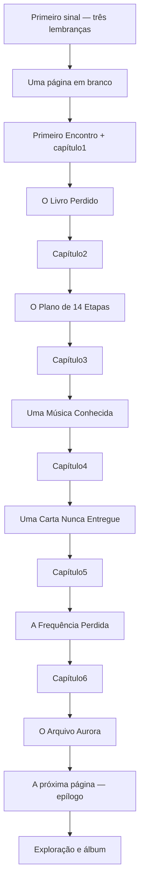

# Aurora 1.15 — campanha única e UX narrativa

Base: Aurora1.1 validada, commit e92a92f / PR25. Branch `feat/aurora-115-narrative-ux`. Sem merge ou deploy.

## Ordem completa

As datas e os títulos canônicos permanecem no álbum; as aventuras fictícias foram intercaladas sem transformá-las em acontecimentos históricos. A ponte existente entre Primeiro Encontro e capítulo1 é uma única missão principal com cenas internas, não duas campanhas concorrentes.

## Interface

Menu normal e tela inicial: **CONTINUAR, MISSÕES, ÁLBUM, EXPLORAR, CONFIGURAÇÕES**. Maria: **CONVERSAR SOBRE A HISTÓRIA, CONVERSAR NORMALMENTE, DESPEDIR-SE**. Temas e IDs permanecem internos. A seleção casual respeita as condições existentes e evita a repetição imediata; não emite eventos da missão principal.

Missões exibe um objetivo principal, contagem, localização, conclusão e botão de localização. Futuras missões não concluídas exibem apenas um bloqueio sem título. Saves antigos podem mostrar conteúdo já conquistado adiante na lista; o próximo conteúdo não concluído permanece bloqueado até a sua vez.

Álbum: **MEMÓRIAS**, **CARTAS E DOCUMENTOS**, **EXTRAS**. Mantidos livros, cartas, fragmentos, fotografia, conquistas, inventário, atividades, conversas, amizades e conclusões. Ler não inicia capítulo; a revisita interativa de capítulo usa o mesmo sistema e uma cópia transitória restaurável de cenas/escolhas/puzzles. Recompensas e progresso principal não são reemitidos.

Ferramentas técnicas ficam fora da navegação normal. Em Vite de desenvolvimento, `?devtools` e Alt+Shift+D abrem o painel interno. O bundle de produção não habilita esse acesso. Mesmo no painel local, os starts normais respeitam a política de desbloqueio.

## Arquitetura preservada

`journey-progress.js` calcula a fase pelos recibos existentes e valida a suspensão/revisita; `journey.js` apresenta e coordena. Adventure, QuestDirector, NarrativeExpansion, DefinitiveScript, Dialogue, Story, câmera, animações e puzzles continuam executando o conteúdo original. Não há novo motor de puzzles, dependência, cena3D ou câmera.

Entradas protegidas: iniciar capítulo/aventura/missão; alvos da expansão; livros/memórias; Maria e NPCs; menus antigos; objetos de encontros legados. HUD, indicador e painel leem a mesma fase. A seleção EXPLORAR pausa os motores principais, preservando o objetivo; CONTINUAR os retoma.

## Migração de saves

| Estado anterior | Tratamento |
| --- | --- |
| Memórias concluídas fora de ordem | Manter todos os IDs válidos, ordenar cronologicamente e buscar a primeira lacuna, sem apagar conquistas |
| Metadados do prólogo ausentes, mas memória histórica presente | Reconhecer o pré-requisito já demonstrado e restaurar metadados de coleta, sem exigir reinício |
| Capítulo futuro em andamento | Guardar grupo/índice em `journey.suspendedScript`; manter cenas, escolhas, itens e puzzles; retomar na sua vez |
| Aventura futura em andamento | Estado `paused`, preservando nó, escolhas e recibos; não iniciar até o pré-requisito correto |
| Missão da expansão fora de ordem | Suspender somente o ponteiro ativo; manter etapas, fragmentos, puzzles e recompensas |
| Livro/partitura de versões antigas | Reutilizar o encontro legado em andamento; não criar uma segunda missão ou recompensa |
| Arquivo e epílogo já concluídos | Reconhecer os recibos; manter a escolha do título e a exploração |
| Revisita interrompida | Persistir snapshot validado; restaurar o progresso anterior ao sair ou concluir |
| Etapa de memória órfã sem a memória correspondente | Manter as demais etapas e permitir recuperar a conclusão canônica, evitando softlock |

Chave e versão externa do save permanecem `lorenzo-maria-v04` /4. Metadados auxiliares `journey.version=1`. Antes da primeira conversão de um save sem esses metadados, guardar cópia exata em `lorenzo-maria-v04-pre115`, sem substituir uma cópia já existente. Se o navegador negar armazenamento, o carregamento não deve ser descartado por uma falha no backup. Voltar para versões antigas que não conhecem os estados suspensos exige restaurar a cópia antiga, não abrir o save convertido diretamente.

Nenhum ID, texto de cena, livro, carta, data ou título histórico foi reescrito. A política de migração não concede recompensas; o reparo idempotente de recibos já existente continua funcionando.

## Validação e evidências

- **260 testes unitários aprovados**; nenhum ignorado/cancelado.
- **Build de produção1.15.0 aprovado**, sem dependências novas. Aviso preexistente de chunks acima de500kB permanece.
- **7 cenários distintos de navegador aprovados**, em execuções segmentadas: campanha completa, menu/Maria, explorar/retomar, migração esparsa/futuras tarefas, leitura pela tela inicial, revisita interativa com reload e conversa casual sem progresso.
- A campanha foi percorrida com coleta inicial, sete aventuras, seis memórias e epílogo, incluindo escolhas e puzzles reais. Checkpoints permitiram corrigir expectativas de teste e aplicar correções isoladas sem repetir as fases já concluídas. A origem dos textos e os marcadores históricos foram preservados.
- Menu de cinco ações inteiramente visível em paisagem; Maria tem exatamente três botões visíveis no menu inicial. Controles essenciais reaparecem nas falas.
- Teste de revisita modificou escolhas/cenas por interação, reabriu o jogo e confirmou restauração exata dos recibos anteriores e ausência de recompensas novas.
- `git diff e92a92f -- src/data public`: vazio. `git diff --check`: aprovado.
- Logs: `work/aurora115/{campaign-flow,campaign-flow-rest,browser-final,last-ui,unit-final-complete,build-final-complete}.log`. Resultados anteriores que falharam continuam nos logs; somente os cenários efetivamente aprovados são contados.

Capturas em [captures/aurora115](captures/aurora115):

| Interface | Antes | Depois |
| --- | --- | --- |
| Menu | [Antes](captures/aurora115/menu-before.png) | [Depois](captures/aurora115/menu-after.png) |
| Maria | [Antes](captures/aurora115/maria-before.png) | [Depois](captures/aurora115/maria-after.png) |

[Álbum](captures/aurora115/album-after.png) · [Missões](captures/aurora115/missions-after.png) · [Revisita](captures/aurora115/review-after.png).

O teste existente de pré-requisitos foi atualizado para verificar preservação do nó suspenso e recusa de start, substituindo a expectativa antiga de apagar o nó. O bloqueio de conteúdo futuro permanece verificado, agora sem destruir progresso válido.

O percurso de campanha utiliza um único save novo, interações DOM/touch, escolhas, puzzles e jogos existentes. Reaberturas reposicionam apenas o jogador em fixtures de teste para reduzir deslocamentos repetitivos; isso não é uma funcionalidade do jogo. Cada fase salva checkpoint para retomar somente o trecho pendente. Navegação física/escadas da versão anterior não foram reimplementadas.

Ambiente Linux/Chromium headless/SwiftShader, 915×412CSSpx e DPR0,5. Não é um benchmark de Galaxy S24 Ultra. Testar em Android físico: menu e opções, joystick/câmera após diálogo, retomada após trocar de app, modo livre e revisitas, legibilidade de documentos longos e os três presets.

## Revisão e pendências

| Problema identificado | Resultado |
| --- | --- |
| EXPLORAR mantinha motores ativos | Corrigido: suspensão imediata, guards e retomada; unitário RED→GREEN e navegador aprovados |
| Story podia emitir visita paralela em outro capítulo | Corrigido: o coordenador controla a campanha; itens originais de capítulo mantidos na conclusão canônica, uma vez |
| Menu de Maria tinha controles redundantes ao lado de despedir-se | Corrigido: três botões visíveis no menu; controles essenciais restaurados nas falas |
| Livro aberto na tela inicial ficava atrás da própria tela | Corrigido: ordem modal e bloqueio de cliques no fundo, sem iniciar campanha |
| Revisita reaberta podia não retomar pelo álbum | Corrigido: o mesmo capítulo retoma sua revisão persistida; CONTINUAR restaura a campanha original |
| Memórias esparsas e tarefas fora de ordem podiam ser apagadas | Corrigido: recibos preservados, suspensão validada e backup exato anterior à conversão |

A revisão independente não apontou outros bloqueadores concretos. Não há regressão crítica conhecida nos fluxos testados. Permanecem pendentes Android físico, todos os tamanhos possíveis de tela e combinações não exercitadas de conversas/saves. O percurso usou fixtures de posição e não substitui uma caminhada física completa novamente; mapas, colisões, escadas e navegação não foram alterados.

O site público não foi atualizado. A entrega está em branch separada para revisão, sem merge ou deploy.
