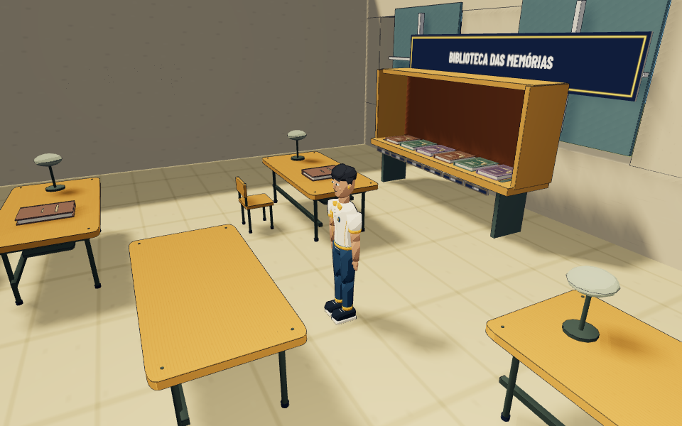
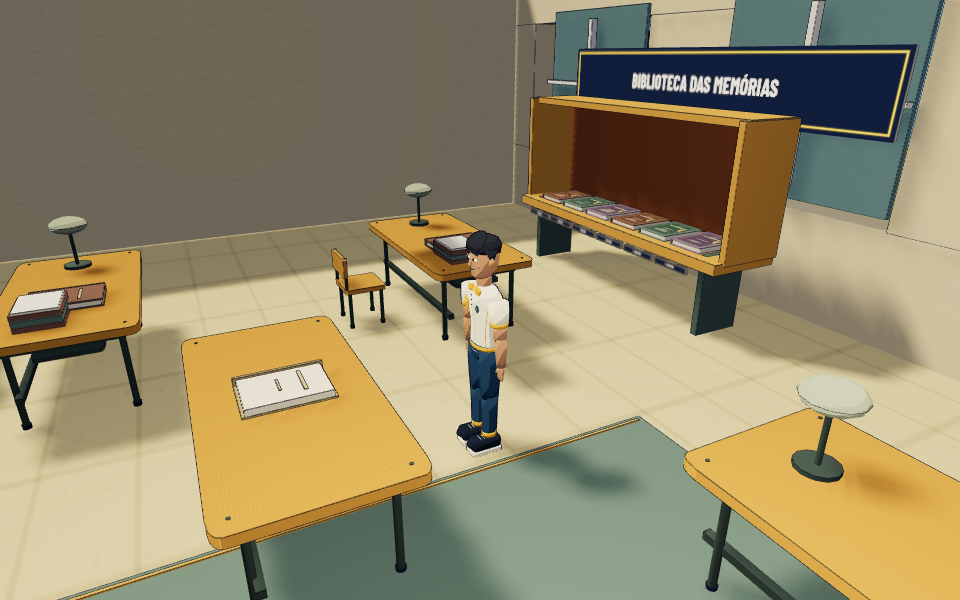
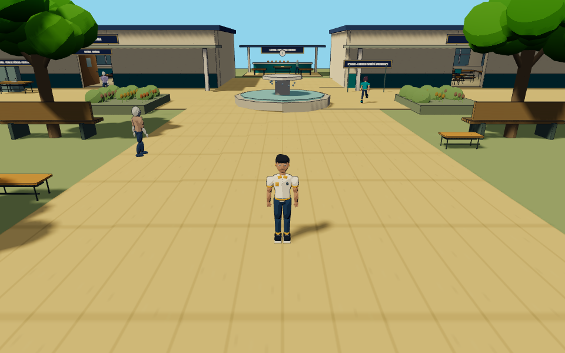
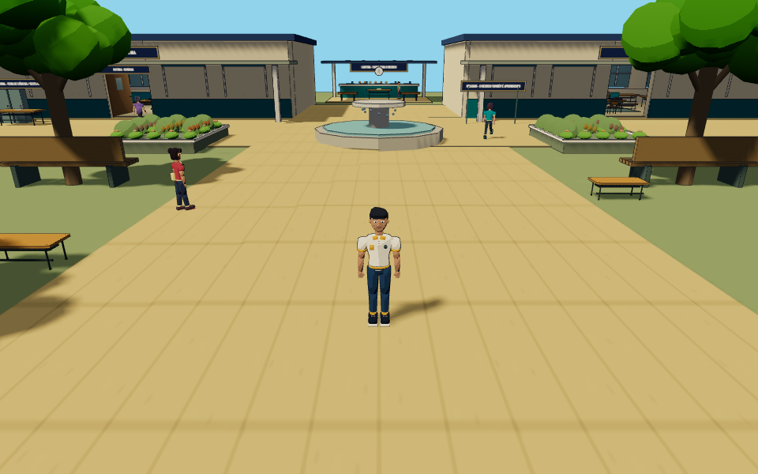
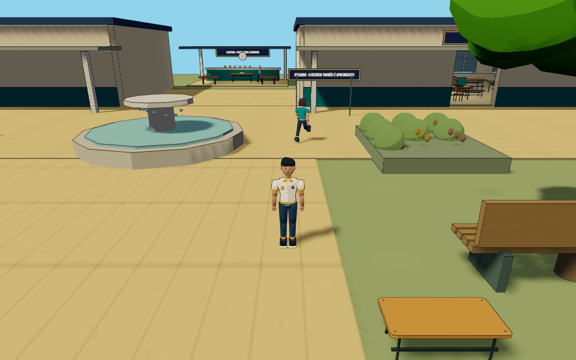
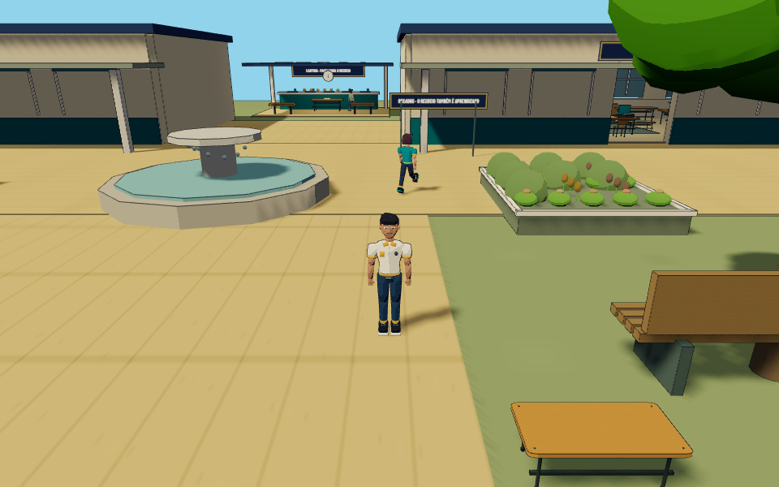

# Entrega · Project Aurora 0.7C

Branch `feat/aurora-07c`, sobre `feat/aurora-07b`. Main preservada. O PR é empilhado sobre a 0.7B porque os PRs anteriores permanecem abertos.

## Implementado

- Biblioteca: três novas estantes, 120 livros volumétricos adicionais, lombadas, pilhas de leitura, passadeira, luminárias e cabos de suspensão. Colisores acompanham as novas estantes sem alterar destinos de navegação. Os seis livros especiais preservam IDs, relatos, datas, travas, abertura articulada, close e retorno à exploração; receberam som de livro e apresentação gráfica do título.
- Pátio/jardim: flores e bordas dos canteiros, detalhes dos bancos, relevos de fachada, bandejas/canecas da cantina e marcações da quadra. Corrigidos contatos dos utensílios e posição das estantes junto às paredes. Sala 0.7A e missões 0.7B não foram reconstruídas.
- Cinco GLBs originais realmente gerados e integrados: Bia, Caio, Helena, Davi e Lia. Cada um tem 18 ossos e 16 clips, materiais toon, cabelo, roupas e acessórios distintos. Rotinas, trajetos, reações e conversas anteriores foram preservados. São personagens fictícios personalizáveis, não retratos reais.
- Áudio sintetizado original para livros, objetos, interface, descoberta, memória, missão, passos e portas; mudo, volumes, debounce e descarte. Sem música comercial ou recursos pagos.
- Efeitos Colorbeat discretos para descoberta/memória/missão/capítulo, pool de até duas unidades e acessibilidade. Movimento reduzido também suprime partículas de coleta em 3D.
- Painéis de história, diálogos, inventário, biblioteca, conquistas, minijogos e configurações têm acabamento angular compartilhado, foco visível, alvos de toque e suporte a contraste/movimento reduzido.
- Carregamento progressivo, cache compartilhado, descarte de fallbacks, consolidação estática, parser GLB sob demanda, presets e resolução adaptativa. Detalhes em [desempenho](PERFORMANCE-07C.md).

## Capturas comparativas reais

Mesma posição salva, câmera, viewport 960×600 e preset Médio; HUD oculto somente para a captura. Antes usa a build 0.7B, depois mostra o polimento 0.7C durante a implementação. As seis imagens e os modelos foram recuperados do GitHub após o reinício do ambiente e tiveram seus hashes verificados.

| Ambiente | Antes | Depois |
| --- | --- | --- |
| Biblioteca |  |  |
| Jardim |  |  |
| Pátio |  |  |

## Verificação e recuperação

Antes do reinício: 83 testes unitários passaram e a build foi gerada. A regressão completa exercitou 55 cenários: 53 passaram e dois detectaram que o novo agrupamento estático retirava parte da geometria de coletáveis. A causa foi corrigida excluindo objetos interativos e seus descendentes da consolidação; os casos que detectaram o problema são reexecutados na conferência final.

O ambiente reiniciou durante essa conferência. Os cinco GLBs e as seis capturas já estavam armazenados no GitHub e foram recuperados byte a byte, com hash Git validado. O código foi restaurado a partir dos patches e novamente verificado; não se presume sucesso dos processos interrompidos. Resultados finais registrados abaixo.

A cobertura inclui movimentação/câmera/colisões, animações, NPCs, diálogos, missões completas, cutscenes interrompíveis, memórias, minijogos, salvamento, controles Android emulados e responsividade. Novos testes validam os cinco rigs/clips, identidade dos materiais, carregamento/fallback, rotinas, orçamentos dos presets, recursos de sombra, efeitos acessíveis e posicionamento dentro das paredes.

## Limitações

Sem medição em Android/Chromebook físicos. Expressividade por pose/cabeça, sem blendshapes faciais ou IK de dedos/pés. Árvores mantêm o sistema instanciado anterior; o jardim foi enriquecido, sem prometer substituição integral da vegetação. Livros cenográficos não criam memórias novas. A apresentação de capítulo é um acento gráfico e diálogo original, não outra missão/cutscene narrativa. Os GLBs ainda não usam Draco/meshopt; o chunk Three mantém aviso de tamanho. Lotes globais têm culling menos granular.

Nenhum recurso pago foi necessário. [Assets e licenças](ASSET-LICENSES.md) · [Direção de arte](ART-DIRECTION-07C.md). Próximas prioridades: testes reais em Android, revisão de expressões/contato e perfil de desempenho antes de adicionar sistemas.

## Terminal do Chromebook

Dentro da pasta do projeto:

```sh
git fetch origin
git switch feat/aurora-07c
git pull --ff-only
npm ci
npm run dev
```

Com o Terminal aberto e o servidor rodando, acessar http://localhost:5173 . O localhost do Chromebook não é um endereço público para o Android.

## Resultado final após recuperação

- **82/82 testes unitários passaram.**
- **8/8 testes integrados focados passaram**, incluindo os dois casos de livros/diagnóstico que detectaram a regressão, NPCs carregados/fallback, rotinas, três presets e contatos/retorno da exploração.
- Build de produção gerada novamente. O smoke de produção verifica sete GLBs HTTP 200 e canvas renderizado; resultado confirmado antes da publicação.
- As 53 verificações não afetadas da execução completa anterior permanecem registradas; não se declara uma nova execução integral de 55 cenários depois do reinício.
- Aviso de tamanho do chunk Three permanece documentado. Favicon SVG original adicionado para eliminar solicitação 404 na produção.

## Arquivos modificados/adicionados

- `README.md`
- `docs/ART-DIRECTION-07C.md`
- `docs/ASSET-LICENSES.md`
- `docs/ENTREGA-07C.md`
- `docs/PERFORMANCE-07C.md`
- `docs/captures/07c/courtyard-after.png`
- `docs/captures/07c/courtyard-before.png`
- `docs/captures/07c/garden-after.png`
- `docs/captures/07c/garden-before.png`
- `docs/captures/07c/library-after.png`
- `docs/captures/07c/library-before.png`
- `index.html`
- `package-lock.json`
- `package.json`
- `public/favicon.svg`
- `public/models/aurora/bia.glb`
- `public/models/aurora/caio.glb`
- `public/models/aurora/davi.glb`
- `public/models/aurora/helena.glb`
- `public/models/aurora/lia.glb`
- `scripts/blender/build_aurora.py`
- `scripts/smoke-production.mjs`
- `src/character-assets.js`
- `src/colorbeat-effects.css`
- `src/main.js`
- `src/systems/asset-pipeline.js`
- `src/systems/audio.js`
- `src/systems/campus-world.js`
- `src/systems/library-garden07c.js`
- `src/systems/living.js`
- `src/systems/quality.js`
- `src/systems/story-world.js`
- `src/systems/story.js`
- `src/systems/visual-effects.js`
- `tests/polish07c.spec.js`
- `tests/unit/effects07c.test.js`
- `tests/unit/environment07c.test.js`
- `tests/unit/npc07c.test.js`
- `tests/unit/quality.test.js`
- `vite.config.js`
