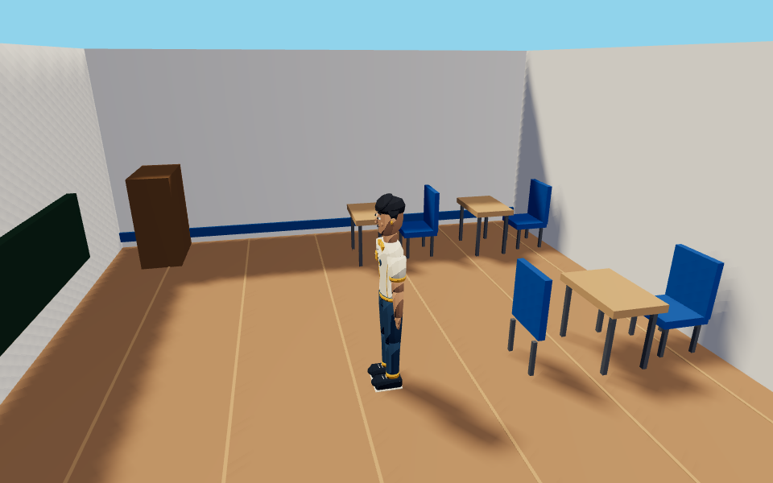
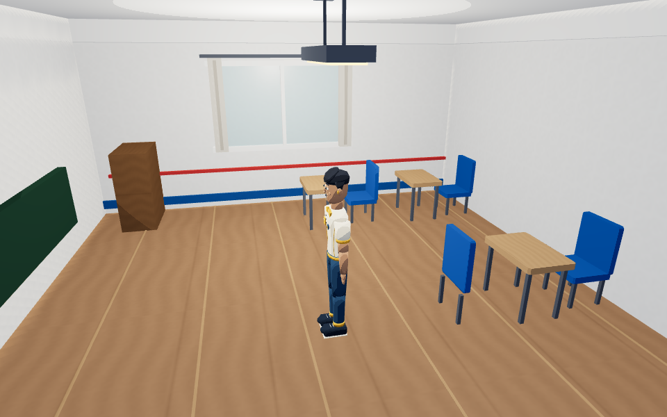
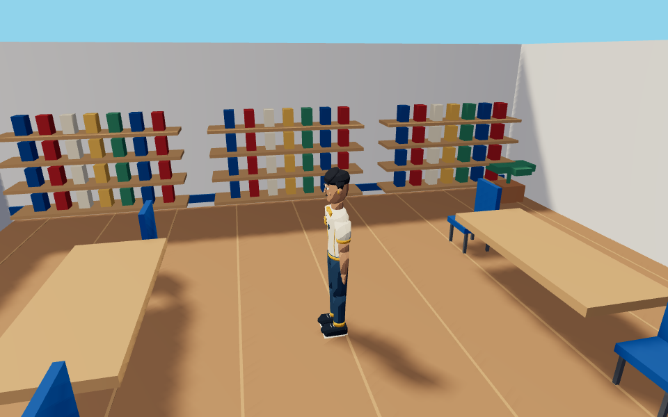
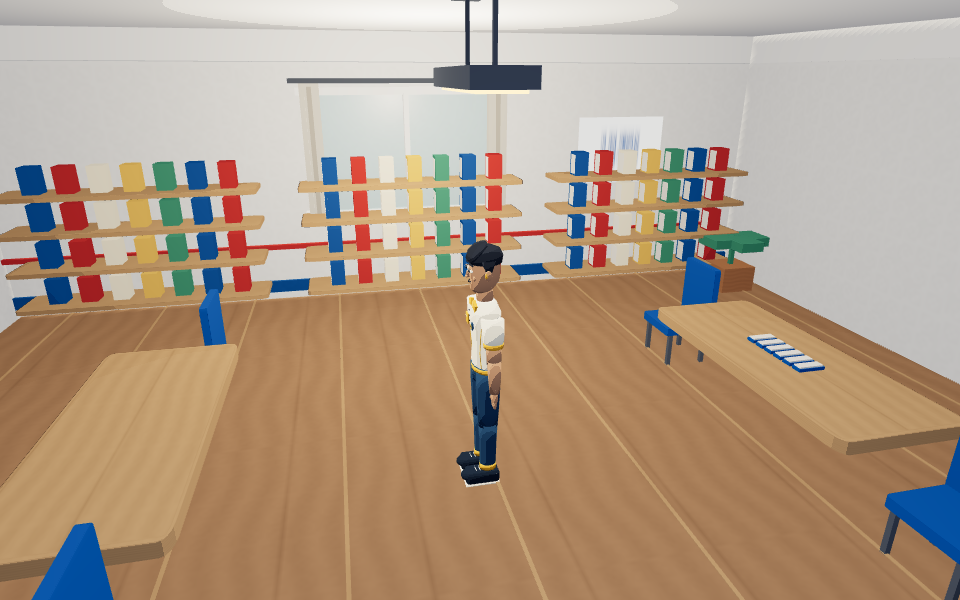
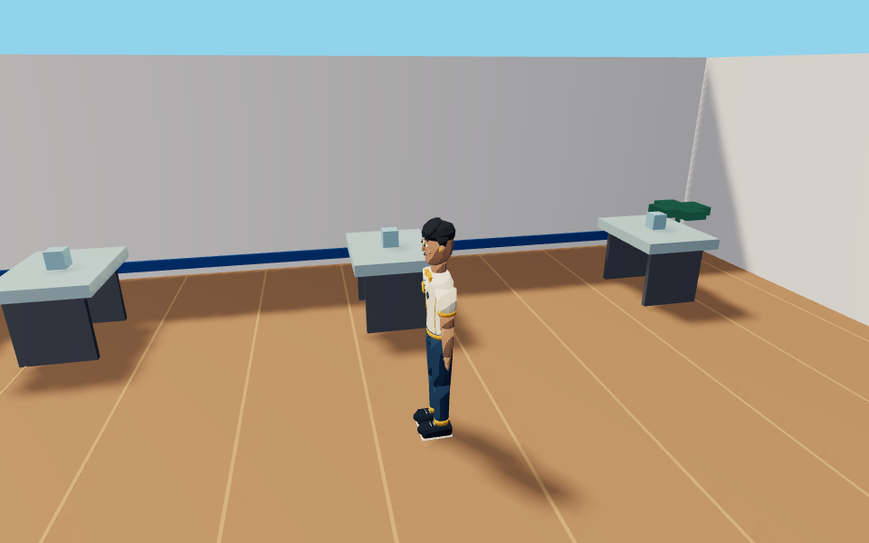
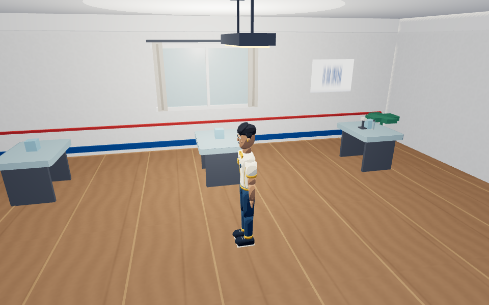
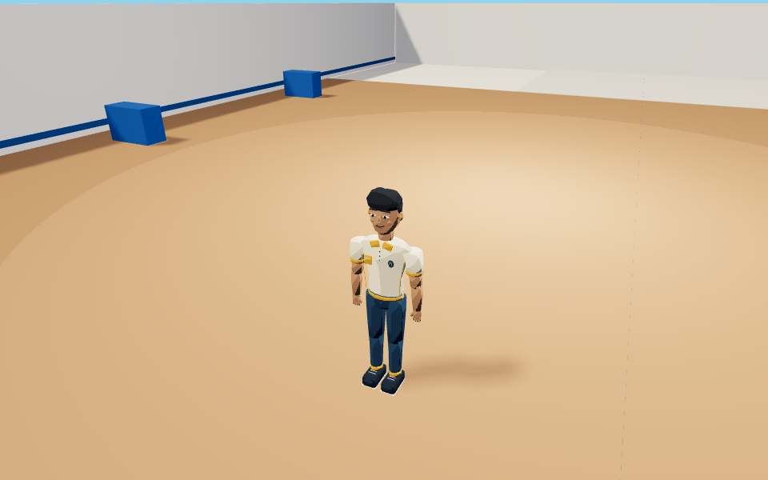
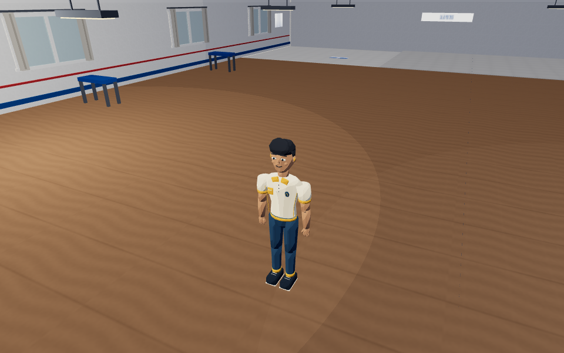

# São Jorge 0.8 · M2

## Implementado

Os três GLBs preparados no M1 continuam como fonte de estrutura e posição. O acabamento assíncrono substitui apenas os móveis provisórios por lotes de geometria refinada, preservando bases e corredores. Madeira, piso, tecido e paredes usam mapas procedurais compartilhados de 64×64; metal, vidro e contornos seletivos completam o Colorbeat.

Carteiras e cadeiras têm bordas suavizadas, pés e cores preservadas. Cadernos, páginas, monitores, materiais de ciências, canecas e livros decorativos apoiam-se nos móveis existentes. Janelas conceituais, cortinas, luminárias, placas por atlas, molduras e fechamento superior melhoram a leitura dos ambientes. O terceiro piso permanece salão aberto.

Luzes limitadas por preset acompanham o ambiente, sem sombras extras de point lights. A inspeção oculta tetos e fechamentos superiores. Geometrias e materiais compartilhados têm descarte separado dos buffers GLB originais. As novas cortinas recebem colisões; saves M1 próximos desses novos volumes são reposicionados para um ponto válido ao entrar.

## Arquivos principais

- Novos módulos `src/systems/school-{materials,furniture,architecture,lighting}.js`.
- Integração em `school-visit.js`, `main.js`; versão em `index.html`, `package.json` e lock.
- Testes unitários dos quatro módulos, navegação combinada e ciclo da visita; cenário de navegador M2.
- Script `scripts/capture-sao-jorge-m2.mjs`, capturas, métricas, plano e inventário de licenças.

## Verificação focada

Reaproveitada a baseline M1 validada (104 testes unitários, 58 cenários e build), sem executá-la novamente. M2: 17 casos unitários afetados passaram ao longo das etapas; quatro cenários de navegador passaram, incluindo navegação nos três pisos, falha de carregamento, controles Android e presets M2. Apenas o cenário visual M2 foi repetido após correções de acabamento. A regressão de save junto à cortina foi reproduzida e corrigida, repetindo somente esse caso unitário.

As verificações cobrem apoio de objetos, rotas, câmera/colisões, descarte, conservação do layout, retorno à campanha e progresso. Build de produção passou (Vite, 77 módulos). O único aviso foi o chunk compartilhado Three.js acima de 500 kB, sem erro de compilação. Smoke na build compilada passou: três GLBs HTTP 200, carregamento progressivo, inspeção, canvas opaco e retorno à campanha, sem erros de console/runtime.

Contadores de renderização na cena automatizada: Baixa 38 chamadas, Média 39, Alta 39; 65.810 triângulos nesse enquadramento. Capturas de ambientes em Média: 29–41 chamadas. São leituras de `renderer.info`, não uma medição certificada de todos os passes ou benchmark de FPS. Dados completos em [M2-RENDER-METRICS-08.json](M2-RENDER-METRICS-08.json).

## Comparativos

Mesma câmera, posição, resolução 960×600 e preset Médio. Antes usa snapshot imutável M1; depois usa M2. Interface foi ocultada para comparar o mundo.

| Ambiente | Antes | Depois |
| --- | --- | --- |
| Sala |  |  |
| Biblioteca |  |  |
| Ciências |  |  |
| Salão |  |  |

## Limites e próxima etapa

Janelas, luminárias, cartazes e proporções são adaptações artísticas; não comprovam medidas ou detalhes reais do colégio. Livros novos são decorativos. NPCs, missões e seis memórias continuam no campus anterior até M3. Patamares mantêm as transições interativas M1, sem escadaria contínua. Não houve teste físico em Galaxy/Chromebook, apenas Chromium e emulação de toque. Nenhum serviço pago foi necessário. Ver [ASSET-LICENSES.md](ASSET-LICENSES.md).

Próxima prioridade: validar visualmente este M2 e planejar M3 sem alterar as histórias documentadas. Nenhum merge automático na main.
