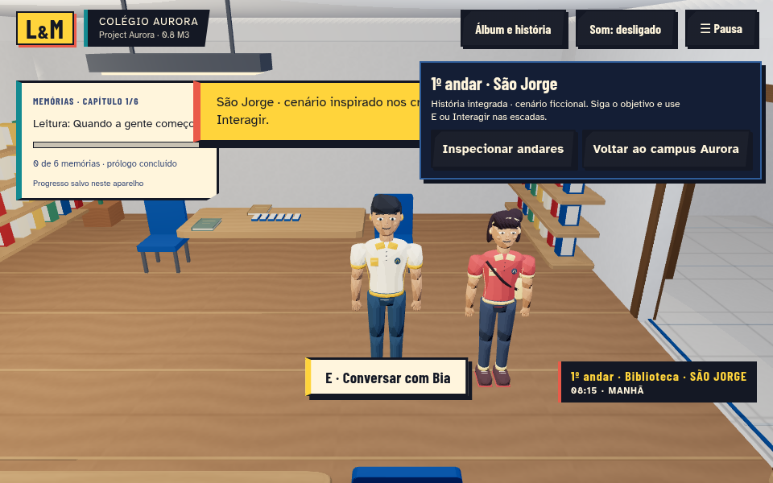
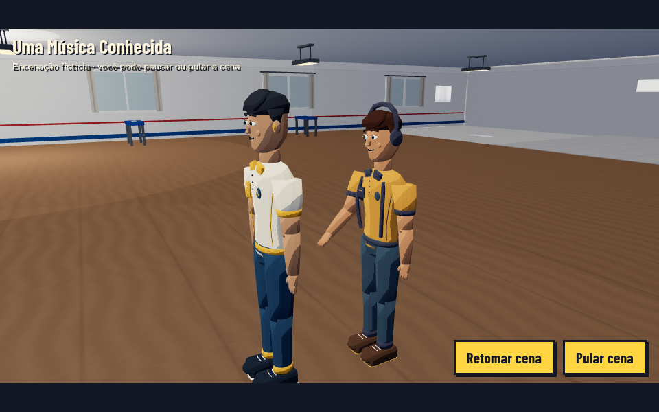
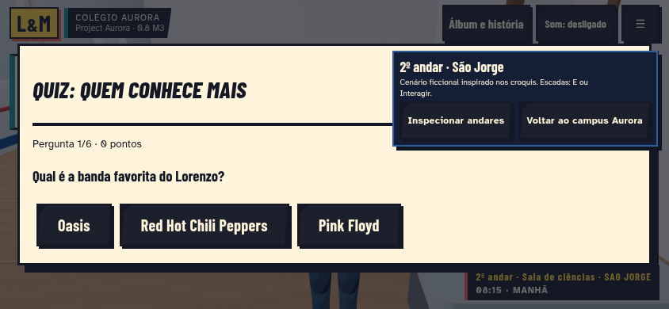
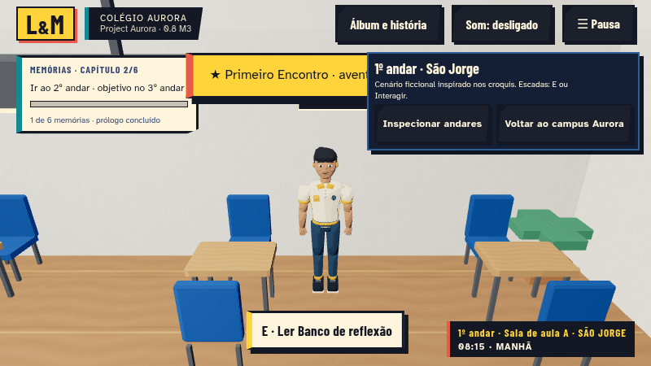

# São Jorge 0.8 — entrega M3

M3 integra a narrativa ao cenário M2. Não conclui o M4 nem modifica a main. Branch `feat/aurora-08-sao-jorge-m3`, PR sobre `feat/aurora-08-sao-jorge-m2`.

## Implementado

- Mesmos seis atores, incluindo Maria, com rotinas locais por andar e restauração das rotinas legadas ao sair.
- Prólogo com os três objetos; três aventuras completas (Primeiro Encontro, O Livro Perdido, Uma Música Conhecida); seis capítulos e livros originais; minijogos de memória, quiz e ritmo.
- Biblioteca recebe os seis livros existentes com capas, datas, bloqueios, abertura e releitura. Objetos são alinhados a superfícies do GLB, sem duplicar seus recursos de GPU. Teclado procedural no salão para a aventura musical.
- Contexto opcional de localização para Story, LivingSchool e Adventure; mesmos estados, escolhas, recompensas e inventário. A visita mantém posição separada do campus legado.
- Objetivos indicam o patamar seguinte quando necessário. Piso e linha de visão impedem interações através de lajes e paredes. Prioridade contextual mantém lembranças selecionáveis ao lado de atividades opcionais.
- Cenas reposicionadas com altura correta, câmera inicialmente orientada aos atores, pausa/salto e restauração. Toolbar e toast são ocultados durante cenas. Leitura pelo álbum mantém a câmera no piso atual; para rever uma conclusão em outro andar, o jogo indica seu ambiente.
- Salvamento validado das posições/rotas locais dos NPCs; saves M1/M2 recebem valores padrão, sem apagar a campanha. Backup pré-0.8 preservado.

## Arquivos

Novos: `school-narrative-map.js`, `school-narrative.js`, testes M3 e `scripts/smoke-sao-jorge-m3.mjs`. Integração em `main.js`, `school-visit.js`, `school-progress.js`, `story.js`, `story-world.js`, `living.js`, `adventure.js` e opção `camera.lookFrom` no `cutscene-manager.js`. UI/versão em `school.css`, `index.html`, package e lock; README, plano, licenças e esta documentação. GLBs, plantas, registros de memórias e capítulos não foram alterados.

## Testes efetivamente executados

Validação focada nas partes afetadas, reutilizando a baseline M2. Não foi repetida a suíte completa.

- 26 casos unitários distintos passaram ao longo das etapas: localização/apoios/rotas, isolamento entre pisos, empréstimo/restauração, prioridade, linha de visão, saves/backup, ciclo da visita, câmera e cutscenes.
- Oito cenários distintos de navegador passaram: as três aventuras completas; seis capítulos em sequência e releitura dos seis livros sem duplicar vales; Android emulado com livro bloqueado, patamar real e quiz; prólogo com três objetos; lançamento de memória/ritmo; enquadramento e salto de cena superior.
- Os percursos longos usam posições de save como fixtures para chegar a cada interação, sem API de teleporte em produção. Isso verifica retomada e interações reais, mas não equivale a caminhar manualmente cada trajeto. Rotas/apoios têm testes de geometria e houve troca real de piso por toque.
- Falhas encontradas e corrigidas: seleção da lua em vez da memória próxima; equipamento de ciências obstruindo o quiz; atividade opcional tomando o lugar da coleta do cartão. Somente os fluxos afetados foram repetidos. Revisão visual também corrigiu câmera inicial e sobreposição do HUD em cenas.
- Uma build de produção passou (79 módulos). Mantém aviso de tamanho do chunk Three.js, sem erro de compilação.
- Smoke sobre a build compilada passou: três GLBs HTTP 200, menu/álbum de seis memórias, inspeção e retorno, cena no terceiro piso com pausa/salto, recompensa, seis posições de atores persistentes e posição legada intacta. Sem erros de runtime/shader observados.

## Capturas

Capturas de execução real com fixtures automatizadas. Biblioteca e cena musical foram atualizadas usando a build final; demais imagens correspondem aos respectivos testes de integração.

## Limitações e próximo marco

As rotinas de cada NPC ficam em um pavimento; não simulam NPCs subindo escadas. A cadeira de reflexão reutiliza uma cadeira existente da sala; não há cenário externo novo. Jardim/pátio são pontos de leitura adaptados: textos e datas originais continuam preservados, sem afirmar que os acontecimentos ocorreram no salão. As escadas mantêm transições por patamar.

Chromium com SwiftShader e Android emulado foram usados; nenhum FPS de Samsung ou Chromebook físico foi medido. O M4 ainda deve fazer o polimento global, benchmark em aparelhos reais, revisão visual abrangente e publicação final. Nenhum recurso pago foi necessário. Veja [NARRATIVE-08-M3.md](NARRATIVE-08-M3.md) e [ASSET-LICENSES.md](ASSET-LICENSES.md).
