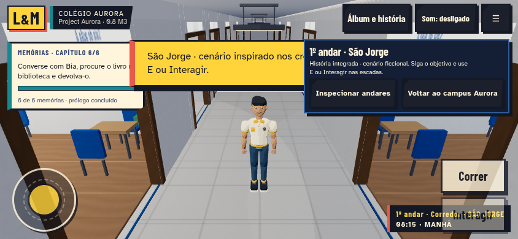
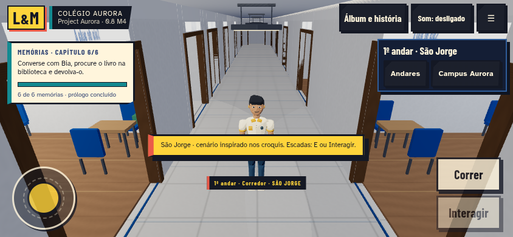
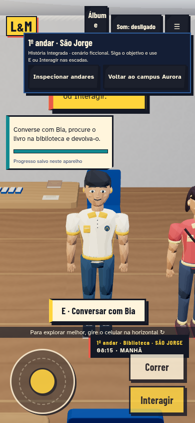
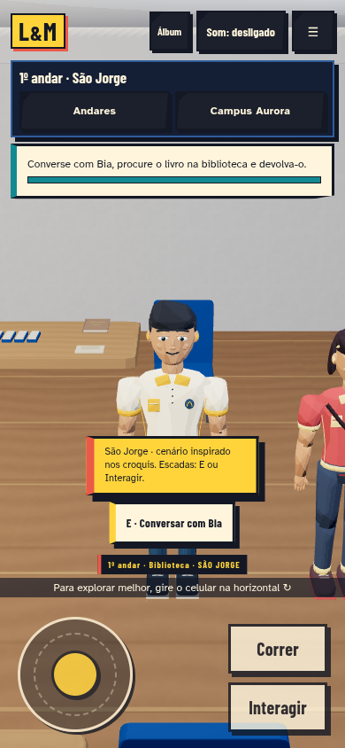
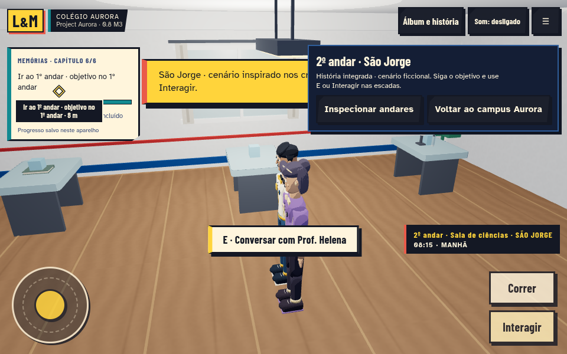
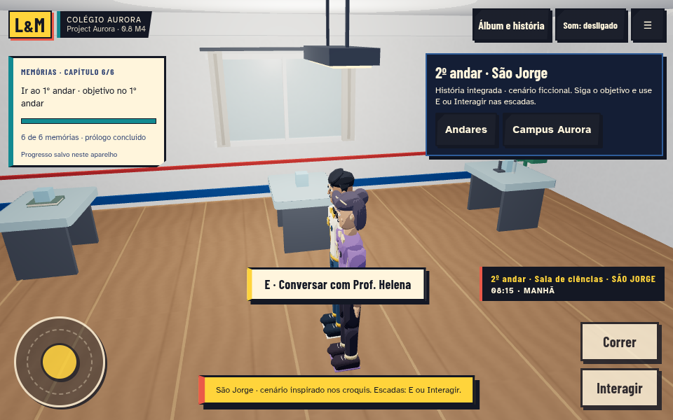
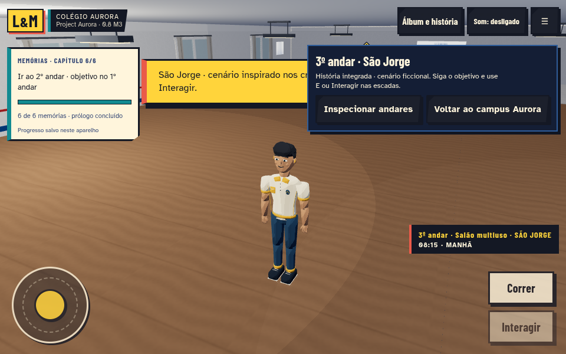
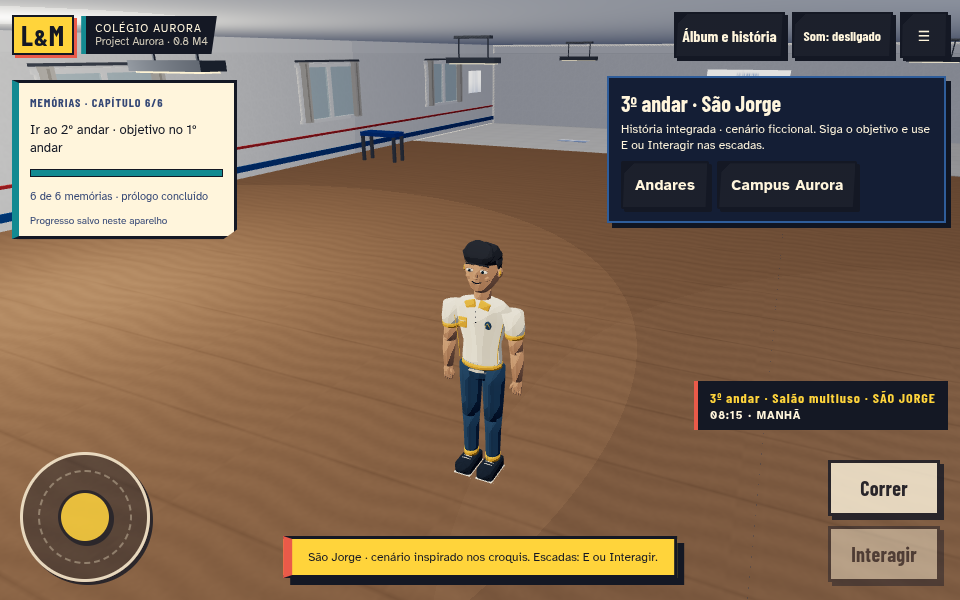

# Project Aurora 0.8 — entrega M4

M4 técnico implementado em `feat/aurora-08-sao-jorge-m4`, sobre M3, com PR separado e sem merge automático na main. A validação em aparelhos físicos continua pendente antes da integração final recomendada pelo pacote.

## O que mudou

- Toolbar compacta, objetivos com quebra de linha, notificações separadas do marcador e localização fora dos botões de toque. Em retrato, o cabeçalho usa um rótulo curto para o álbum. Nomes acessíveis e áreas mínimas de 44 px são mantidos.
- Inspeção oculta HUD de missão, localização, marcador e controles que não são usados nela; ao voltar, eles retornam. Cenas cinematográficas continuam com seus controles próprios.
- NPCs distantes deixam de renderizar/animar em Baixa, mantendo suas rotinas. Sombras só em Alta e perto do jogador, sem afetar as silhuetas. Troca de qualidade e chegada tardia de GLB atualizam a política corretamente.
- Menos consultas repetidas de missão e obstáculos por atualização. Corrigido também o uso do objeto Group em vez de sua posição nas rotinas: NPCs passam a olhar para Lorenzo com orientação finita durante conversas.
- Versão de pacote 0.8.0 e UI 0.8 M4. Arquitetura, GLBs, histórias, datas, missões e formato de progresso foram preservados.

## Verificação realizada

A baseline M3 já validou as três aventuras, seis capítulos e minijogos. Ela foi reaproveitada; esses percursos longos e a suíte completa não foram repetidos.

- **10 testes unitários focados passaram**: apresentação por distância/piso/preset, consultas compartilhadas, rotinas de NPCs ocultos, orientação de conversa, GLB tardio e regressões de localização/apoio/seleção do M3.
- **3 cenários Playwright novos passaram**: movimento por teclado e colisão com parede, patamar e altura do segundo piso, órbita por mouse e inspeção; HUD retrato/paisagem e conversa por toque com rotação finita; três visitas completas com contadores de GPU estáveis e campanha intacta.
- Capturas e contadores dos três presets em quatro pontos reais, com todos os personagens carregados. Medições finais substituem a primeira captura intermediária feita antes da correção de orientação.
- Uma build de produção passou. O aviso do chunk Three.js maior que 500 kB permanece; não houve erro de compilação.
- Smoke da build compilada reutiliza `scripts/smoke-sao-jorge-m3.mjs`: três GLBs HTTP 200, álbum com seis memórias, inspeção/retorno, cena superior com pausa/salto, conclusão/recompensa e posições dos seis atores persistentes. Passou sem erros de runtime/shader observados. Capturas da build final em `captures/08-m4/production/`.

## Evidência visual

Mesmos pontos e viewports, preset Médio; atores e notificações são elementos dinâmicos. Antes: snapshot M3. Depois: M4. As capturas de retrato e paisagem incluem o HUD real.

| Enquadramento | M3 | M4 |
| --- | --- | --- |
| Corredor / paisagem |  |  |
| Biblioteca / retrato |  |  |
| Ciências |  |  |
| Salão |  |  |

## Desempenho e limites

No corredor em Baixa: 119 → 101 chamadas e 114.794 → 83.966 triângulos. Nas outras cenas, as chamadas principais ficaram iguais. Três ciclos de visita terminaram com 166 geometrias e 29 texturas, sem crescimento. Veja [PERFORMANCE-08-M4.md](PERFORMANCE-08-M4.md) e os dados brutos. Não houve medição em Samsung/Chromebook físicos, nem promessa de FPS.

As escadas continuam sendo transições por patamar, as rotinas dos NPCs ficam em seu pavimento e os ambientes são adaptações ficcionais. Não se acrescentaram instalações reais presumidas. A versão não usa recursos pagos. Nenhum asset externo novo: [ASSET-LICENSES.md](ASSET-LICENSES.md).

## Arquivos e atualização

Principais arquivos: `school-presentation.js` novo, `school-narrative.js`, `main.js`, `school.css`, `index.html`, package/lock; novos testes e script de captura; documentação e imagens desta entrega. O histórico M1/M2/M3 continua preservado.

No Terminal Linux do Chromebook, dentro da pasta do projeto:

```sh
git fetch origin
git switch feat/aurora-08-sao-jorge-m4
git pull --ff-only origin feat/aurora-08-sao-jorge-m4
npm ci
npm run dev
```

Abra `http://localhost:5173` e escolha **Visitar São Jorge · 0.8 M4**. Para testar em Android pela rede local, use o endereço de rede exibido pelo Vite, com o computador ligado e ambos na mesma rede; no Chromebook, pode ser necessário encaminhar a porta 5173 nas configurações Linux. Isso não é um link público de hospedagem.

Próxima prioridade: validação física e revisão do PR antes de integrar e publicar a build na hospedagem escolhida. Nenhuma hospedagem ou main foi atualizada automaticamente.
