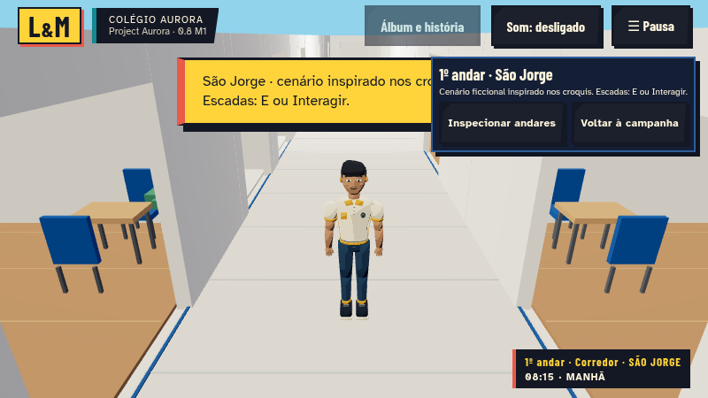
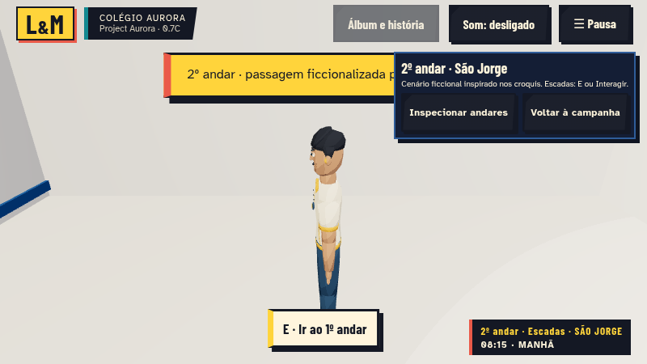
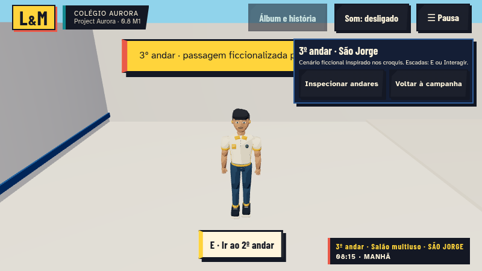
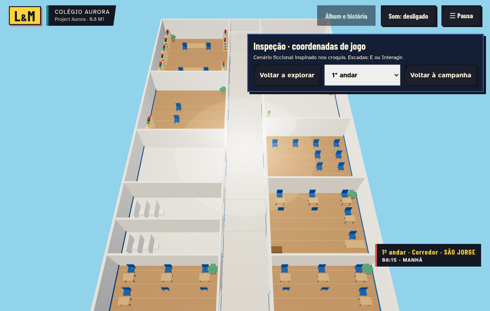
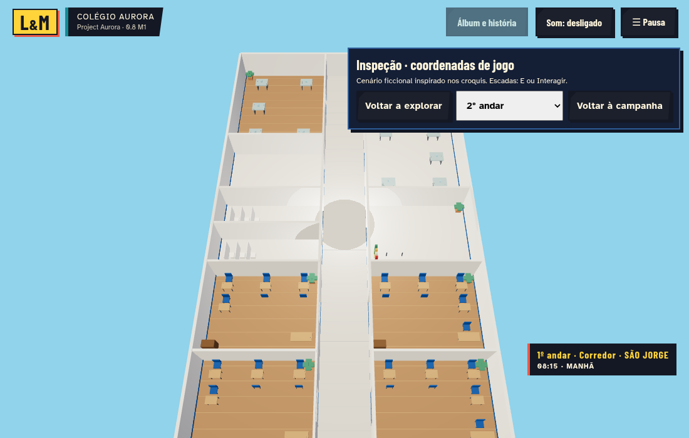
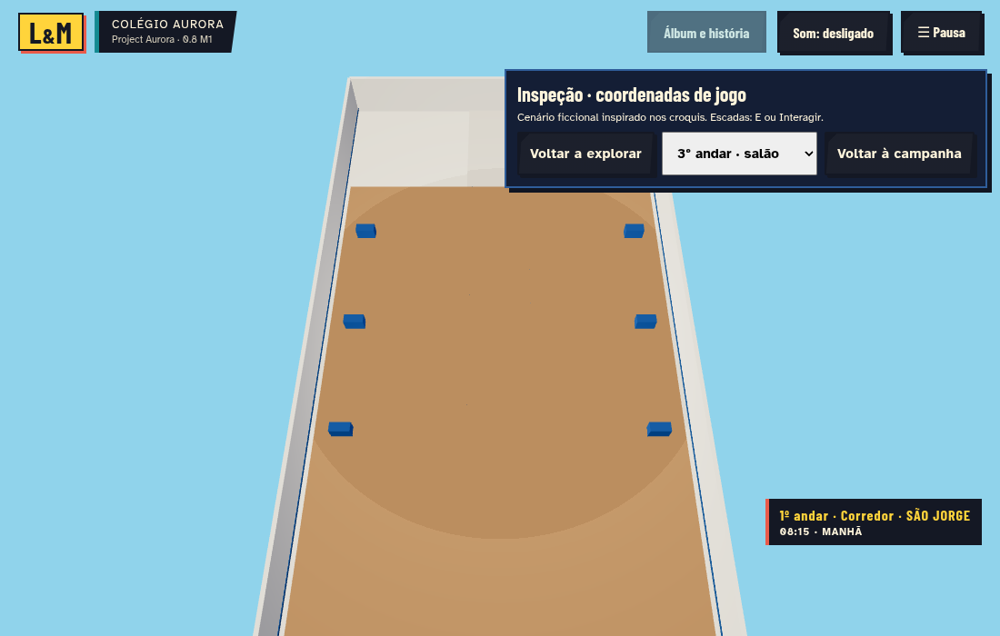
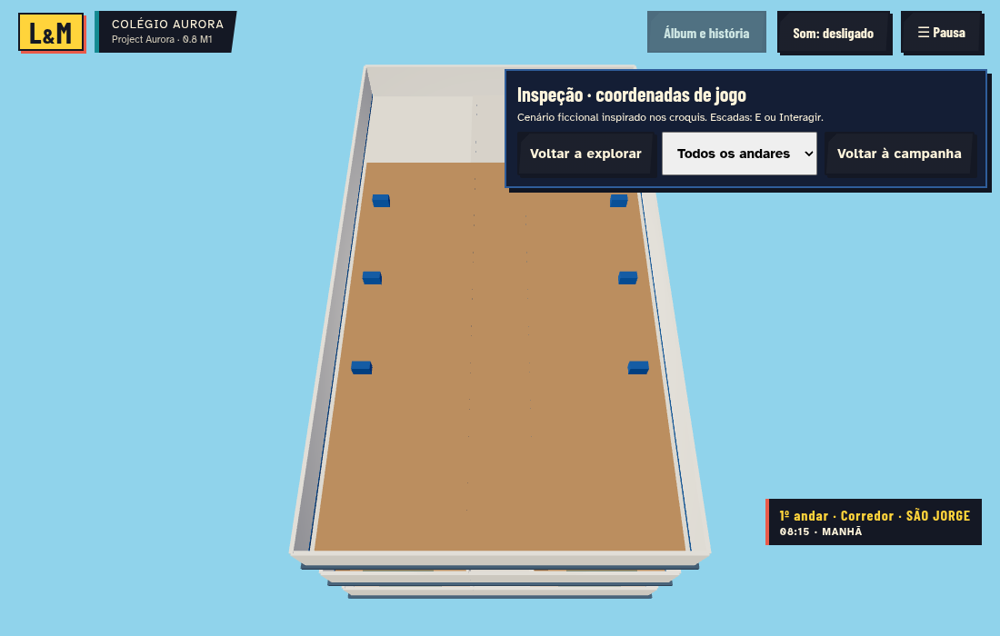

# Project Aurora 0.8 · entrega parcial M1 — São Jorge

> Estado consolidado em 09/11/2026: integração de M1–M4 e das bases 0.7A/B/C na `main`, por solicitação expressa do usuário. Os registros abaixo preservam o histórico de cada marco. Validação em aparelhos físicos e publicação da hospedagem continuam pendentes.

**Esta entrega conclui apenas a auditoria e o M1. A versão 0.8 completa não está concluída.** M2 (detalhamento), M3 (remapeamento narrativo) e M4 completo dependem da validação desta etapa.

Base: 0.7C `ef5a7414c6223e66679edf1f35f934c809740f33`, contendo 0.7A/B/C. Branch `feat/aurora-08-sao-jorge`; PR empilhado sobre `feat/aurora-07c`, pois os anteriores ainda estão abertos. Nenhuma alteração direta na main. Ver [auditoria](AUDITORIA-08-M1.md) e [plano](superpowers/plans/2026-11-08-sao-jorge-m1.md).

## Como testar

Na tela inicial, **Visitar São Jorge · 0.8 M1**; durante a campanha, **Pausa → Visitar São Jorge · M1**. A visita usa o mesmo jogador, câmera, animações, controle de teclado/mouse/Android e cena 3D. Não é o visualizador HTML externo do pacote.

Caminhe pelo corredor e entre nas salas. No ambiente das escadas, aproxime-se do patamar e pressione **E / Interagir**. O segundo piso tem pontos separados para subir e descer. As transições são cortes para patamares seguros: ainda não há escadaria contínua com rampas/aberturas nas lajes.

**Inspecionar andares** libera 1º/2º/3º/todos. A opção todos separa visualmente os pisos apenas para inspeção; não altera alturas do jogo, colisões ou save. **Voltar a explorar** restaura o piso e os ângulos da câmera. **Voltar à campanha** restaura o campus e posição anteriores.

O piso ativo e a posição da visita são retomáveis após recarregar. As posições da campanha permanecem separadas; missões, memórias, NPCs e minijogos continuam acessíveis no campus 0.7. Durante visita, narrativa e rotinas legadas ficam suspensas. O reposicionamento de NPCs, seis livros e aventuras dentro da nova escola pertence ao M3 e não foi antecipado.

## Estrutura implementada

- Três GLBs efetivamente preparados a partir dos três GLBs individuais fornecidos, decodificando seus vértices, lajes e móveis. Preservados 664/501/33 volumes da origem, conforme metadados de cada arquivo. O GLB combinado foi auditado e arquivado como referência, sem duplicá-lo junto aos individuais na cena.
- Organização de ambientes dos dois croquis preservada: corredor longitudinal, salas de aula, banheiros M/F, professores, biblioteca, cinema, recepção, secretaria e direção no primeiro; salas, banheiros, ciência, coordenação e laboratório no segundo. Terceiro: um salão, sem palco ou foyer presumidos.
- Paredes e vãos de jogo reparados, normais planas, cores lineares Colorbeat, três camadas por piso (`structure`, `furniture`, `floors`), um material compartilhado com cores por vértice, sem texturas pesadas.
- Carregamento assíncrono por piso e cache no pool existente. Inicialmente só é solicitado o piso necessário; falha mantém a campanha ou o patamar anterior. Descarte trata cargas tardias e compartilha GPU corretamente.
- Colisões selecionadas por andar: vergas acima da cabeça não bloqueiam o caminhar, mas continuam bloqueando câmera. Limites laterais, portas abertas, spawns validados e recuperação de saves em posições inválidas.
- Câmera acompanha a altura real do personagem. Patamares têm checagem de proximidade; não são comandos de teletransporte disponíveis em qualquer local.
- Extensão de save v04 mantém campo separado `schoolVisit`. O registro original é preservado uma vez em `lorenzo-maria-v04-pre08` antes de sobrescrever; falha de backup impede a gravação, e registro atual corrompido pode recorrer ao backup.

[Matriz por ambiente e proveniência](SAO_JORGE_ROOM_MATRIX.md). Os números de salas conceituais não são tratados como números reais. Dimensões, posição exata de portas, alturas, circulação e mobiliário são adaptações em unidades de jogo; não foi afirmado levantamento arquitetônico real. Não há infraestrutura de segurança ou operação restrita modelada.

## Capturas reais do jogo





As capturas são geradas pelo teste que caminha até as escadas, percorre os três pisos e recarrega o jogo. Não são renders externos nem imagens conceituais. As capturas finais usam a identificação 0.8 M1; o estilo Colorbeat 0.7C foi preservado.

## Testes

Baseline anterior à edição: 82 unitários e build aprovados. A primeira integração passou os três testes de navegador novos. **Validação final: 104/104 unitários, 58/58 cenários de navegador, build e smoke de produção aprovados.** A suíte completa foi repetida após corrigir os dois testes de orçamento gráfico da primeira rodada; os limites permaneceram <160 chamadas e <110 geometrias no cenário Baixo testado.

Foram incluídos testes para proveniência dos GLBs, acesso aos 24 ambientes, patamares, paredes finas, deslizamento, exclusão de sólidos de outros pisos, teto/câmera, save/backup/quota, cache, falha/cancelamento e inspeção retomável. A revisão independente identificou e corrigiu a reentrada assíncrona em inspeção após cancelamento; o carregamento mantém menus legados bloqueados até encerrar ou cancelar, com teste próprio de cancelamento. A inicialização aplica culling de mundo/NPCs antes do primeiro render, evitando uma tela inicial acima do orçamento por falta da primeira atualização ativa.

## Limitações e próximas etapas

M1 tem acabamento de maquete jogável: móveis conceituais reaproveitados, portas abertas, sem teto visual completo ou detalhamento premium de todos os ambientes. Planos de teto para a câmera são volumes lógicos; rampas/IK e escadaria contínua não foram implementados. Não há missão nova nem narrativa histórica inventada.

M2: validar reconhecimento visual com o usuário e detalhar materiais/ambientes, sinalização e contatos. M3: integrar biblioteca das seis memórias, NPCs, missões e cenas no novo mapa com migrações testadas. M4: ampliar polimento, testes de hardware, otimização e publicação final da 0.8.

Sem medição em Android/Chromebook físicos nesta sessão. Não se promete 30/60 FPS; três presets e resolução adaptativa foram preservados. Nenhum serviço pago, assinatura, crédito de geração ou asset pago foi utilizado. [Licenças e origem](ASSET-LICENSES.md).

## Inspeção estrutural






Essas vistas usam a própria câmera do jogo. Na inspeção o personagem é ocultado; as chamadas de desenho desse modo não incluem o custo de renderizá-lo. A exploração normal continua em terceira pessoa.

A preparação pode ser repetida com `python3 scripts/prepare-sao-jorge.py`. As capturas extras podem ser repetidas com Vite ativo e `node scripts/capture-sao-jorge08.mjs`; `CHROMIUM_PATH` permite indicar um Chromium de sistema. O smoke da build usa `node scripts/smoke-sao-jorge08.mjs` com preview ativo em 4173 ou `SMOKE_URL` configurado.

## Medições reais desta etapa

Chromium headless com SwiftShader, viewport 1100 × 700, DPR 1, preset Baixo e sombras desligadas. Não são medições em telefone físico. Contagem de geometrias inclui recursos já carregados da campanha e da visita.

| Vista | Chamadas de desenho | Geometrias GPU | Triângulos/passagens |
| --- | ---: | ---: | ---: |
| exploration-floor-1 | 16 | 77 | 21800 |
| 0 | 3 | 77 | 8580 |
| 1 | 3 | 80 | 6588 |
| 2 | 3 | 83 | 540 |
| all | 9 | 83 | 15708 |

[Dados brutos](M1-RENDER-METRICS-08.json). Na exploração o personagem está visível; na inspeção ele fica oculto. Números mudam com vista, qualidade e recursos carregados. Não se declara FPS físico. Pisos carregados ficam em cache nesta etapa, sem descarregamento LRU; o descarte do pool ocorre ao encerrar a aplicação.

## Atualizar no Terminal do Chromebook

Dentro da pasta do jogo:

```sh
git fetch origin
git switch feat/aurora-08-sao-jorge
git pull --ff-only
npm ci
npm run dev
```

Com o servidor ativo, abrir http://localhost:5173 no Chromebook. Na tela inicial, escolher **Visitar São Jorge · 0.8 M1**. O endereço localhost do Chromebook não é um link público para o celular.

## Registro final de verificação

- `npm run test:unit`: **104 pass**, zero falhas.
- Playwright: **58 pass**, zero falhas, execução integral de aproximadamente 10 minutos. Usado Chromium do sistema com SwiftShader e as mesmas especificações/configurações de teste do projeto, por um override local de executável. Os limites dos testes legados não foram relaxados.
- `npm run build`: aprovado. Entrada ~308 kB / 79 kB gzip; Three ~569 kB / 148 kB gzip. O aviso de chunk Three >500 kB é anterior e permanece documentado.
- `scripts/smoke-sao-jorge08.mjs`: três GLBs HTTP200, carga progressiva, inspeção, canvas e retorno à campanha aprovados na build.
- Capturas: três pavimentos em exploração, três vistas por piso e uma vista de todos.
- Revisões independentes: navegação, propriedade de recursos, saves e cancelamento de cargas. Bugs encontrados foram corrigidos antes desta entrega.

Para repetir em outro ambiente: `npm ci`, `npx playwright install chromium`, `npm run test:unit`, `npm test`, `npm run build`. O override local de Chromium não é necessário quando os browsers padrão do Playwright estão instalados. Para verificar a build, subir `npm run preview` e executar o smoke, com `SMOKE_URL` se a porta não for 4173.

A versão completa 0.8 continua pendente. O próximo passo é validar este M1 em Chrome no Chromebook e no Android antes de iniciar M2. Nenhum merge foi feito.

## Continuação M3

A integração narrativa foi implementada em branch própria sobre M2. Veja [ENTREGA-08-M3.md](ENTREGA-08-M3.md) e [NARRATIVE-08-M3.md](NARRATIVE-08-M3.md). M4 permanece pendente; esta atualização não declara a 0.8 inteira concluída.

## Fechamento técnico M4

HUD móvel, orçamento de apresentação dos NPCs e revisão automatizada implementados em branch própria sobre M3. Veja [ENTREGA-08-M4.md](ENTREGA-08-M4.md) e [PERFORMANCE-08-M4.md](PERFORMANCE-08-M4.md). Preservadas as etapas M1/M2/M3. Validação em aparelhos físicos e integração/publicação da hospedagem permanecem pendentes; nenhum merge automático na main.

## Integração da versão completa na main

O PR final consolida toda a cadeia de desenvolvimento, preservando o histórico e as branches. A main anterior era `06a21652c1c3ac0dac212a198ff849f0dde5b6f4`; ela é ancestral da versão M4 validada, sem commits divergentes. Para esta integração, somente README e este registro foram atualizados; código, modelos e configuração de produção são os mesmos já testados no M4. Não foi repetida a suíte de testes por não haver mudanças no conteúdo executável.
