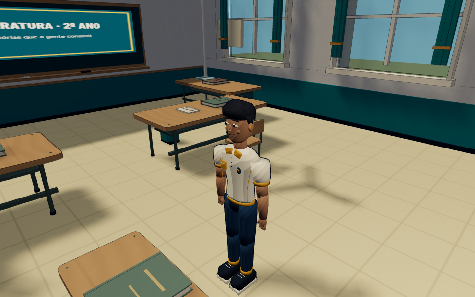
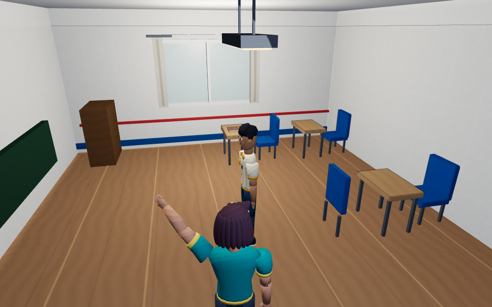

# Colorbeat 0.8.1 — M1 + M2

Entrega das duas primeiras etapas solicitadas, sobre a `main` 0.8 completa (`f05e1c0`). Branch `feat/aurora-081-colorbeat-unified`. **Não representa a conclusão do M3/M4 da 0.8.1; nenhum merge automático.**

## Unificação efetiva

`Resources` é agora o proprietário de uma única `ColorbeatMaterials`. `SchoolMaterials` é uma fachada que empresta o mesmo cache, mapas e rampa; o loader GLB também usa esse proprietário para materiais vertex-color. Materiais equivalentes nos dois campi são literalmente a mesma instância. O descarte de visita/GLB não libera recursos compartilhados; o proprietário os libera uma única vez.

O shader toon usa uma rampa compartilhada de três faixas, com transição suavizada somente nas bordas para reduzir aliasing. A luz principal é quantizada; preenchimentos locais têm difusão contínua para evitar anéis nas salas. Luz direta não ilumina o lado oposto da superfície. Madeira, pintura, concreto, tecido, plástico, metal e vidro têm parâmetros próprios. Metal/plástico recebem pequenos realces especulares estilizados; foscos ficam sem esse brilho. Vidro permanece Standard transparente, com depthWrite desligado e sem sombras opacas de painéis.

Mapas neutros procedurais 64×64 são compartilhados. O shader projeta suas coordenadas em unidades do mundo para manter a leitura de madeira/piso/tecido nos dois cenários. Não foi necessário duplicar geometrias para mudar UVs ou importar texturas externas. Aliases de carvalho e pintura são usados apenas onde o ambiente identifica esses materiais; não se infere madeira a partir de cores de cabelo/pele.

A exposição passou a ter um único alvo (1.0), substituindo 1.0/1.16 do campus e 1.05 fixo do São Jorge. Sol e hemisfério usam perfis interpolados de exterior/interior, com a mesma família de preenchimentos por qualidade. A biblioteca mantém luz mais quente. O controlador respeita a posse do sol pelo CutsceneManager durante cenas.

O traço estático usa a mesma tinta e opacidade nos ambientes. Mesas e encostos do São Jorge recebem uma única camada de perímetros selecionados por piso, desativada em Baixa. Não foram contornados pequenos detalhes nem introduzido pós-processamento.

## Preservação

Não houve alterações em GLBs, esqueletos, proporções, expressões, animações, distribuição dos ambientes, dados dos seis capítulos, missões, colisões, controles ou formato de saves. As mudanças nos construtores de cenário selecionam acabamento, sem mudar posições ou dimensões. O comportamento de visita/retorno continua o mesmo. A integração física do prédio permanece fora desta entrega, para 0.9.

A auditoria foi focada em materiais, iluminação, loaders, traço e seus pontos de uso: [AUDITORIA-081-M1.md](AUDITORIA-081-M1.md). A referência pública já registrada em [REFERENCIAS-HIFI-RUSH.md](REFERENCIAS-HIFI-RUSH.md) orienta a linguagem; nenhum asset ou shader de Hi-Fi RUSH foi copiado.

## Capturas reais comparáveis

Mesma posição, câmera, viewport e preset Médio em cada par; animações/atores são dinâmicos. Antes usa snapshot imutável da 0.8. Nove enquadramentos cobrem os oito itens pedidos e uma sala São Jorge adicional. Android usa Chromium com toque emulado, 844×390; demais vistas, 960×600. HUD oculto somente nos enquadramentos de arte, preservado na imagem Android.

| Vista | Antes 0.8 | Depois M1/M2 |
| --- | --- | --- |
| Campus original | [Imagem](captures/081/campus-before.png) | [Imagem](captures/081/campus-after.png) |
| Sala original | [Imagem](captures/081/campus-classroom-before.png) | [Imagem](captures/081/campus-classroom-after.png) |
| Sala São Jorge | [Imagem](captures/081/school-classroom-before.png) | [Imagem](captures/081/school-classroom-after.png) |
| Corredor São Jorge | [Imagem](captures/081/school-corridor-before.png) | [Imagem](captures/081/school-corridor-after.png) |
| Biblioteca | [Imagem](captures/081/library-before.png) | [Imagem](captures/081/library-after.png) |
| Laboratório | [Imagem](captures/081/laboratory-before.png) | [Imagem](captures/081/laboratory-after.png) |
| Salão | [Imagem](captures/081/hall-before.png) | [Imagem](captures/081/hall-after.png) |
| Personagem próximo | [Imagem](captures/081/character-close-before.png) | [Imagem](captures/081/character-close-after.png) |
| Android emulado | [Imagem](captures/081/android-ui-before.png) | [Imagem](captures/081/android-ui-after.png) |

## Testes e problemas corrigidos

Durante o desenvolvimento, foram executados conjuntos focados de materiais/shaders, cache/descarte, assets/rigs, apoios, acabamento, navegação da visita e iluminação. Cinco casos novos cobrem compartilhamento real, shader/vertex-colors/skinning preservados, exposição/cutscenes, seleção semântica de superfícies e vidro sem sombra opaca. Há também regressão específica do lote de contornos e sua qualidade/descarte.

Dois novos cenários de navegador passaram: diálogo no campus e visita aos três pisos com presets/retorno/save; laboratório Android com multitouch real via CDP e ausência de erros. O teste existente contra faixas indevidas em parede plana passou sem relaxar seu limite. A investigação isolou o artefato comparando sombras ligadas/desligadas; a correção ficou no shader, não na tolerância do teste. O primeiro teste de toque usava eventos sintéticos incompatíveis com captura de ponteiro; a fixture foi corrigida para tocar de verdade no navegador, sem alterar os controles do jogo.

A build final passou (82 módulos). O aviso pré-existente de chunk Three.js >500 kB permanece. O smoke da build compilada passou: três GLBs HTTP 200, álbum de seis memórias, inspeção/retorno, cena superior com pausa/salto, recompensa e posições de atores persistentes; nenhum erro de runtime/shader observado.

**Regressão final completa:** o workflow do PR executa `npm run test:unit`, `npm run build` e `npm test`. O resultado conclusivo fica nos checks do PR. Essa é a única execução completa de finalização; não foi duplicada localmente. Foi removida a chamada isolada de `tests/colorbeat.spec.js` no CI porque os mesmos testes já fazem parte de `npm test`.

## Métricas e limites

Contadores de `renderer.info`, com todos os modelos carregados e shader real; não são FPS nem certificação de todos os passes de sombra. Comparativos brutos: [METRICAS-081-M1-M2.json](METRICAS-081-M1-M2.json). A camada seletiva acrescenta um draw por piso visível em Média/Alta; compartilhamento de recursos reduz duplicações. Distinguir o acabamento plástico separa um lote adicional em alguns ambientes. No campus: 250 → 245 chamadas; sala original: 126 → 123; corredor São Jorge: 124 → 126. As texturas reportadas no corredor passaram de 45 para 41 e as geometrias de 155 para 152. Nem toda cena terá menos chamadas.

Sem medição física em S24 Ultra/A35/Chromebook. O estilo ainda tem diferenças legítimas de iluminação e materiais por ambiente; não foi feita reconstrução arquitetônica para forçar imagens idênticas. A revisão de contornos de personagens com espessura adaptativa, de interface e de efeitos é o próximo marco M3; o polimento/benchmark abrangente é M4. Não se declara a 0.8.1 inteira pronta.

## Arquivos principais

Novos: `colorbeat-materials.js`, `colorbeat-lighting.js`, script de captura, testes, auditoria, métricas e esta entrega. Alterados: `resources.js`, `school-materials.js`, `asset-pipeline.js`, `atmosphere.js`, `school-lighting.js`, `main.js`, `batching.js`; seletores de acabamento dos construtores de mundo/sala; traço estático e móveis/arquitetura escolares; versão em HTML/package; CI sem passo duplicado. Licenças em [ASSET-LICENSES.md](ASSET-LICENSES.md).
