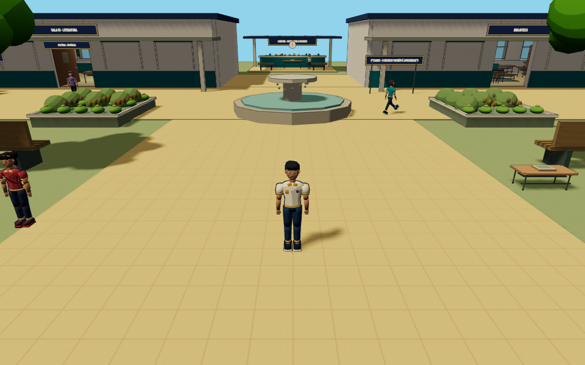
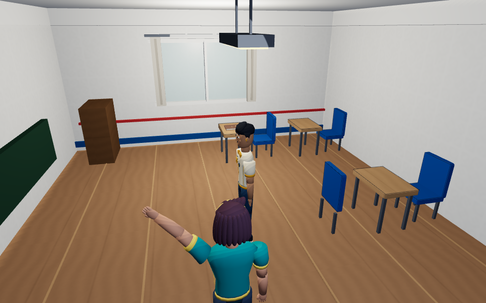
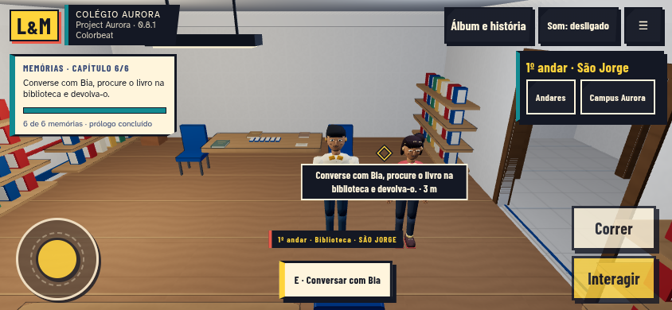

# Project Aurora 0.8.1 — M3 e M4

Continuação de [M1/M2](ENTREGA-081-M1-M2.md) na mesma branch `feat/aurora-081-colorbeat-unified`, PR #9 para `main`, sem merge automático. Base 0.8 completa: `f05e1c0`. O campus e os três andares do São Jorge mantêm seus ambientes, mobiliário e comportamento de visita.

## M3 — Personagens, interface e feedback

Os sete avatares fictícios existentes — Lorenzo, Maria, Bia, Caio, Helena, Davi e Lia — continuam sendo seus GLBs originais, com os mesmos esqueletos, cores, proporções, expressões e clipes. O importador reconhece `shirt`/`pants`/`fabric`/`cloth` como tecido fosco. Pele, cabelo e olhos mantêm o perfil anterior. O tecido usa o mesmo shader central, sem textura em coordenadas do mundo que pudesse deslizar sobre a roupa animada. Nenhum modelo foi reexportado ou substituído.

O contorno rígido e o skinned usam um único material proprietário de InkOutlines. A extrusão acontece na projeção, depois dos chunks Three de morph e skinning de posições e normais. A largura é de 0,9/1,15/1,4 pixels CSS nos presets Baixo/Médio/Alto, com limite de expansão equivalente a 0,018 unidades do mundo à distância. O viewport CSS mantém o peso visual quando DPR ou resolução adaptativa muda; o raster de resolução baixa ainda pode serrilhar. Preservam-se as máscaras de grupos para não desenhar traços internos pesados no rosto, o recorte por distância dos NPCs e a versão reduzida de baixo custo. Nenhum novo passe de tela ou pós-processamento.

O marcador contextual é uma única geometria de colchetes amarelos, reutilizada somente quando existe objeto próximo e elegível. Respeita o depth test, fica oculto nos modais/inspeção/sem alvo e não marca permanentemente NPCs. Sua pequena variação de escala para com movimento reduzido. Geometria e material são descartados uma única vez, sem liberar recursos emprestados de modelos. Os feedbacks anteriores de descoberta/memória/missão continuam limitados a dois elementos simultâneos e suprimidos com movimento reduzido.

A barra São Jorge passou a usar os tokens Comic de tinta, papel, amarelo e turquesa, as mesmas fontes locais, bordas angulares, foco e hover. Menus de pausa, cartões, diálogos e controles secundários compartilham o acabamento; o layout responsivo anterior permanece. A toolbar inativa fica visualmente oculta durante pausa, diálogo e menus: `inert` sozinho bloqueava entrada, mas deixava o painel de z-index alto desenhado sobre a leitura. Um teste Android reproduziu o problema e passou com a correção de visibilidade, sem mudar os controles. Há tratamento de alto contraste e forced-colors, sem recriar o sistema de controles. Inventário, álbum, conquistas e minijogos continuam sendo telas reais ligadas ao progresso.

## M4 — Verificação e comparativos

Capturas reais em Chromium headless/SwiftShader, preset Médio. Antes: snapshot imutável da 0.8 (`f05e1c0`). Final: branch 0.8.1 com M1–M4. Mesmas posições, yaw/pitch e viewports; NPCs/poses podem diferir porque a simulação continua ativa. As imagens `*-after.png` continuam registrando M1/M2; `*-final.png` registram a entrega completa. Nenhuma imagem de referência substitui uma captura real.

| Enquadramento | 0.8 antes | 0.8.1 final |
|---|---|---|
| Campus | [Antes](captures/081/campus-before.png) | [Final](captures/081/campus-final.png) |
| Sala campus | [Antes](captures/081/campus-classroom-before.png) | [Final](captures/081/campus-classroom-final.png) |
| Sala São Jorge | [Antes](captures/081/school-classroom-before.png) | [Final](captures/081/school-classroom-final.png) |
| Corredor | [Antes](captures/081/school-corridor-before.png) | [Final](captures/081/school-corridor-final.png) |
| Biblioteca | [Antes](captures/081/library-before.png) | [Final](captures/081/library-final.png) |
| Laboratório | [Antes](captures/081/laboratory-before.png) | [Final](captures/081/laboratory-final.png) |
| Salão | [Antes](captures/081/hall-before.png) | [Final](captures/081/hall-final.png) |
| Personagem próximo | [Antes](captures/081/character-close-before.png) | [Final](captures/081/character-close-final.png) |
| Android paisagem | [Antes](captures/081/android-ui-before.png) | [Final](captures/081/android-ui-final.png) |
| Menu Android | [Antes](captures/081/ui-menu-before.png) | [Final](captures/081/ui-menu-final.png) |
| Diálogo Android | [Antes](captures/081/ui-dialogue-before.png) | [Final](captures/081/ui-dialogue-final.png) |
| Pausa Android | [Antes](captures/081/ui-settings-before.png) | [Final](captures/081/ui-settings-final.png) |
| Álbum Android | [Antes](captures/081/ui-album-before.png) | [Final](captures/081/ui-album-final.png) |

## Testes e preservação

Durante M3: 11 testes unitários focados (materiais, shaders, propriedade de recursos, animação do traço, marcador e acessibilidade dos efeitos) e seis testes de navegador passaram. Os casos novos foram observados falhando antes da implementação: espessura ainda fixa, roupa sem perfil próprio e toolbar com tema divergente. A verificação em navegador compilou os shaders reais nos sete GLBs, exercitou animação, viewport/presets, menus Android, movimento reduzido, três pavimentos, retorno, diálogo, save e multitouch real por CDP.

Na revisão M4, um alvo legado sem altura explícita foi corrigido para herdar a posição mundial do objeto apoiado: o teste de suporte no andar superior passou. Os três casos finais de navegador passaram, incluindo coleta com o destaque, pausa, alto contraste e retorno aos menus. A build final passou (84 módulos). O smoke de produção passou: três GLBs HTTP 200, seis livros, inspeção/retorno, cena superior com pausa/salto, recompensa e posições dos seis atores persistentes; nenhum erro de runtime/shader observado.

Regressão completa final: executada pelo workflow do PR: `npm run test:unit` e `npm run build` uma vez; `npm test` particionado em dois shards disjuntos, cada teste em apenas um lote; resultado conclusivo publicado nos checks do PR. Testes focados e smoke de produção têm registros separados nesta entrega. Não se atribui o resultado anterior M1/M2 aos commits novos. Uma tentativa em um único runner atingiu o limite de 18 minutos sem conclusão; a divisão preserva todos os casos, limites e asserts e adiciona relatório por teste/JSON, evitando apenas o gargalo de duração por runner.

Dados narrativos e modelos não foram alterados. Física, controles, navegação escolar, dados das missões e esquema de salvamento não foram reescritos. Não se implementou a integração física São Jorge–campus da 0.9.

## Desempenho, limites e arquivos

Consulte [PERFORMANCE-081.md](PERFORMANCE-081.md) e [METRICAS-081-M4.json](METRICAS-081-M4.json) para contadores reais e amostras reproduzíveis de frame time. Não houve teste físico em Galaxy S24 Ultra, A35 ou Chromebook. As metas de 60/30 FPS permanecem metas a verificar; emulação por software não certifica esses aparelhos. Os contornos continuam sujeitos a aliasing em resolução reduzida; não foi adicionado antialiasing de pós-processamento pesado. O bundle Three.js mantém o aviso preexistente de chunk acima de 500 kB.

Principais alterações M3/M4: `actor-ink-material.js`, `ink-outlines.js`, `asset-pipeline.js`, `colorbeat-materials.js`, `interaction-accent.js`, `main.js`, `colorbeat-effects.css`; scripts de captura, testes focados, documentação, versão e workflow de artefatos. Revisão final do autor em passagem separada do diff; não houve revisão independente adicional. Licenças em [ASSET-LICENSES.md](ASSET-LICENSES.md). Nenhum recurso pago.
